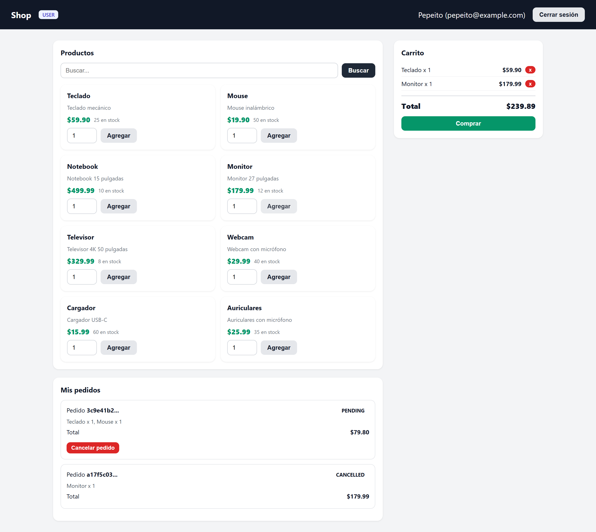
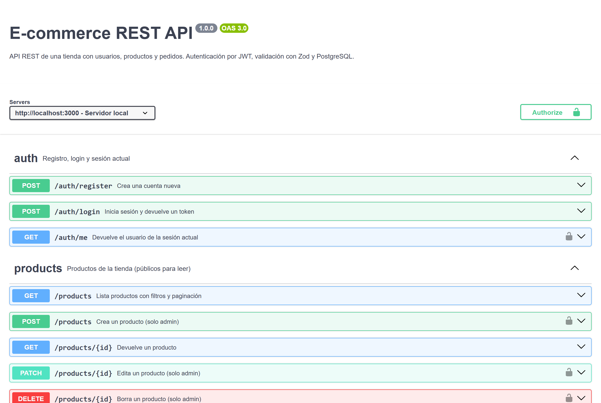

# ecommerce-rest-api

The backend of an online shop: JWT accounts, customer and admin roles, a catalog with stock, orders, and stats for the admin. `public/` has a small page that uses the API, so you can try it without Postman.



It's built with Node.js, TypeScript and Express. Data lives in PostgreSQL through Prisma, input is validated with Zod, and tests use Vitest with Supertest.

## Running it

You need Node.js 20 or newer and Docker.

```bash
npm install
cp .env.example .env
docker compose up -d db
npm run db:migrate
npm run db:seed
npm run dev
```

The API runs at http://localhost:3000, the demo page at the root and Swagger UI at `/docs`. The seed creates an admin account and a customer account; their details are in `prisma/seed.ts`.

`JWT_SECRET` is required: without it in `.env`, the server won't start.

## Endpoints

| Route | What it does | Access |
|---|---|---|
| `POST /auth/register`, `POST /auth/login` | Create an account and get a token | Public |
| `GET /auth/me` | The logged-in user | Logged in |
| `GET /products`, `GET /products/:id` | Catalog, with filters and pagination | Public |
| `POST`, `PATCH`, `DELETE /products` | Create, edit and delete products | Admin |
| `GET /orders`, `GET /orders/:id` | Your own orders (admins see all of them) | Logged in |
| `POST /orders` | Place an order | Logged in |
| `PATCH /orders/:id/cancel` | Cancel an order and put the stock back | Owner or admin |
| `GET /users`, `GET /stats` | Users and shop stats | Admin |

The full contract is in `docs/openapi.json`.



## How it's put together

Every resource goes through the same layers: the route validates the request with its Zod schema, the controller deals with HTTP, and the service holds the logic and talks to Prisma. Errors are thrown as `HttpError`, and a single middleware turns them into the response.

```
src/
  routes/        routes and validation
  controllers/   request and response
  services/      business logic and Prisma
  schemas/       Zod schemas
  middlewares/   auth, admin, validation and errors
prisma/          schema, migrations and seed
tests/           integration tests
```

Some decisions:

- Prices and totals are `Decimal` in the database and in the code, never `float`.
- Placing an order is a single transaction: the products are checked, the stock is taken out, and the order is saved with the price at that moment. The stock goes down with a conditional update (`stock >= quantity`), so two simultaneous orders can't sell the same last unit. Cancelling is also a transaction, and it puts the stock back.
- Helmet, CORS and a per-IP request limit are on by default.

## Tests

```bash
npm test
```

They're integration tests against a real database, the one in `TEST_DATABASE_URL`, which is wiped before every run. They cover auth, products, orders (including two people buying the last unit at the same time) and stats. GitHub Actions runs them against PostgreSQL 16 on every push to main and every pull request.
